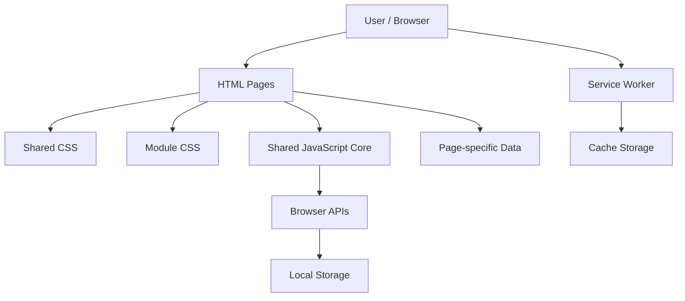

# Architecture Overview

## Architectural Style

Asisten Penghulu Web v5.2 menggunakan pendekatan **static multi-page application**. Setiap fitur utama memiliki dokumen HTML sendiri, sementara aset bersama dipakai lintas halaman.

## Layers

### 1. Presentation
- `index.html`: dashboard.
- `pages/*.html`: halaman fitur.
- `assets/css/app.css`: gaya global.
- `assets/css/modules/*.css`: gaya spesifik fitur.

### 2. Application Logic
- `assets/js/app-core.js`: fungsi bersama dan inisialisasi berdasarkan atribut `data-page`.
- `assets/js/pwa.js`: registrasi Service Worker.

### 3. Content Data
- `assets/js/data/wali-data.js`
- `assets/js/data/mahar-data.js`
- `assets/js/data/khutbah-data.js`
- `assets/js/data/nasihat-data.js`
- `assets/js/data/bank-nasehat.js`
- `assets/js/data/knowledge.js`

Data modul dimuat pada halaman yang memerlukannya, bukan dari beranda.

### 4. Offline Capability
- `manifest.webmanifest`: metadata aplikasi web.
- `sw.js`: cache shell, halaman, dan aset yang diminta.
- `assets/fonts/AsistenNaskh.ttf`: font Arab lokal.

Cache offline bergantung pada browser, ruang penyimpanan, HTTPS/localhost, dan halaman/aset yang pernah dimuat.

## Deployment

Tidak ada tahap kompilasi. Root repository berisi `index.html`, sehingga dapat dipublikasikan sebagai static site.

- Vercel: output directory `.`.
- Netlify: publish directory `.`.

## Data and Privacy

Aplikasi tidak memiliki server-side database atau account system. Penyimpanan browser yang digunakan oleh fungsi tertentu tidak tersinkronisasi antarperangkat. Jangan memasukkan data pribadi sensitif ke dalam aplikasi tanpa mekanisme tata kelola dan perlindungan yang sesuai.
